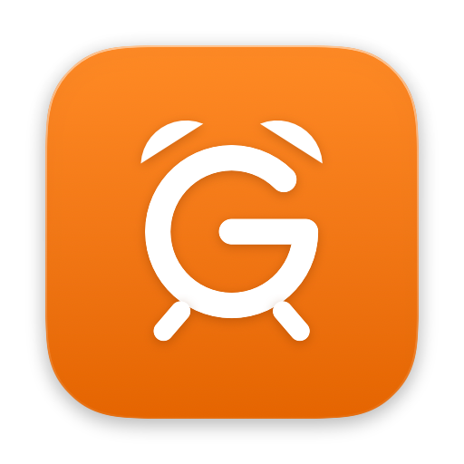

<p align="center">
  
</p>

<h1 align="center">GoTime</h1>

<p align="center">A macOS menu bar countdown to your next meeting, with alarms you can't miss.</p>

<p align="center">
  
  
  
  
</p>

## What it does

- **Countdown in the menu bar.** Your next meeting and the time left, in an orange pill. It turns yellow 10 minutes before, red with seconds 2 minutes before, and flashes "Join now" at start.
- **Today at a glance.** Hover or click the pill for today's meetings, a Join button (⌘J), an alert bell per meeting, New meeting (⌘N), Settings and Quit (⌘Q).
- **Alerts that get louder:**

  | When | What you get |
  | --- | --- |
  | 10 min before | Banner |
  | 5 min before | Banner, sound and Join |
  | 1 min before | Alert that stays until you Join or Snooze |
  | Start time | Full-screen alarm on every display, sound every 10 s until you Join, Snooze or Dismiss |

  The alerts are GoTime's own windows, so Focus and Do Not Disturb don't hide them.
- **One-click Join** for Google Meet, Zoom, Microsoft Teams and Webex links in the event.

## Build and run

Needs macOS 14 or later and Xcode or the Command Line Tools.

```bash
./build.sh
open build/GoTime.app
```

`build.sh` compiles a release build, runs the self-test, generates the app icon and puts together an ad-hoc signed `build/GoTime.app`.

## Permissions and privacy

- On first launch GoTime asks for Calendar access. It reads the calendars in the macOS Calendar app, so to see a Google calendar, add the account in System Settings › Internet Accounts.
- Nothing leaves your Mac. GoTime makes no network requests and has no analytics; your settings stay in the app's local preferences.

## License

[MIT](LICENSE)
